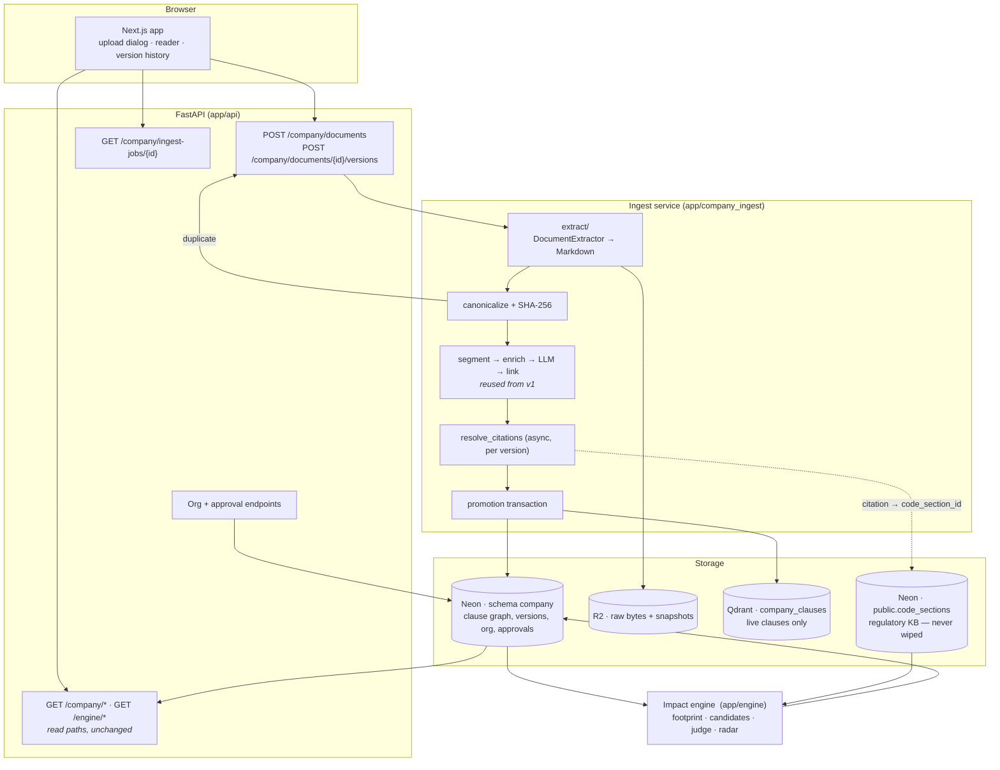
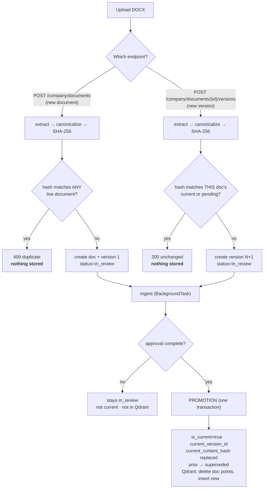
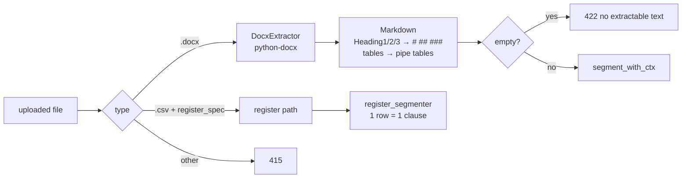
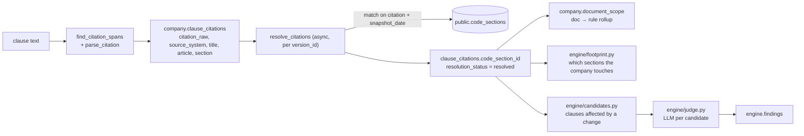
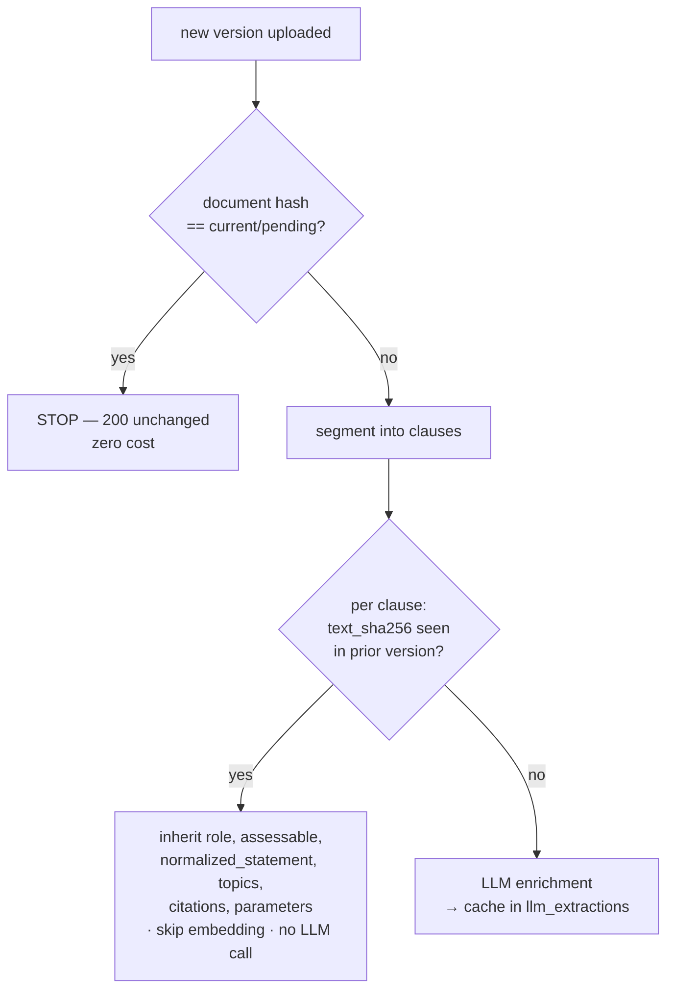
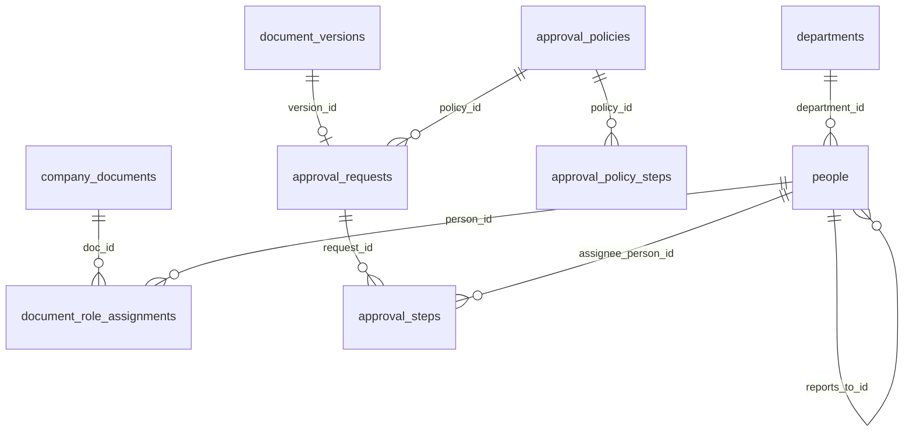

# Architecture — Company Document Ingestion (v2)

**Status:** target architecture. Supersedes `development_docs/company_docs_ingestion_old.md`, which describes the v1 corpus-walking design.
**Scope:** how customer documents enter the system, become a clause graph, map to regulations, and version over time.
**Related:** `TDD.md` (contracts and DDL), `implementation_plan.md` (execution order), `development_docs/document-change-detection.md` (original rough proposal).

---

## 1. What changed from v1, and why

v1 ingested a hand-authored synthetic corpus from disk. Three structural consequences made it unsuitable as a product foundation:

| v1 behaviour | Problem |
|---|---|
| `app/api/company/routes.py` opened `app/company/corpus/_global/*.csv\|yaml` on live requests | The application could not run without synthetic data present |
| `collect/collector.py` walked `CORPUS_ROOT` and classified files by literal path segments (`corpus/docs/<ID>/data/`) | Customer uploads have no such shape |
| `enrich_citations` was called without a `code_section_repo` | Every citation committed as `code_section_id = NULL`. The 1,284 resolved links in production exist only because `scripts/backfill_citations.py` was run by hand |
| Content hashes computed but never compared; child PKs not version-scoped; no query filtered by version | Re-ingest was wasteful, and a second document version would silently drop its citations and double every document's clause set |

v2 keeps the clause graph — which is sound, generic and already populated with 2,334 clauses and 4,675 links — and replaces **intake, identity and versioning**.

### Invariants v2 establishes

1. **Deletability.** `backend/synthetic/` can be removed with no effect on the running application. CI-enforced.
2. **One hash per document.** `company_documents.current_content_hash` is the single content hash. Superseded versions keep none.
3. **One current version per document.** Enforced by a partial unique index, not by convention.
4. **Qdrant holds only live clauses.** Drafts, in-review and superseded versions are never indexed.
5. **Regulation links are produced in-pipeline**, per document, with no manual backfill step.
6. **Versions are immutable** and numbered by the system.

---

## 2. Component map



**Ownership boundaries**

| Layer | Owns | Must not |
|---|---|---|
| `app/api` | HTTP contracts, status codes, tenancy | contain pipeline logic |
| `app/company_ingest/extract` | file format → Markdown | know about HTTP or the DB |
| `app/company_ingest` (rest) | clause graph construction | read the filesystem for corpus data |
| `app/engine` | impact analysis | reference `synthetic/`, `corpus/` or `RPL-` |
| `backend/synthetic` | demo data + seeder | be imported by anything in `app/` |

---

## 3. The two entry points

Redlining is out of scope, so a document's content changes only by uploading a new version.



**Why the duplicate check differs by endpoint.** A new document is checked **company-wide** — the objective-3 case is the same content arriving under a different title, so identity must be name-independent. A new version is checked **against that document only**, because the question there is "has anything changed?", not "have I seen this anywhere?".

**Why nothing is stored on a duplicate.** The order is: read bytes → extract → hash → check → *then* write. A rejection happens before the first R2 object or database row exists, so there is no cleanup path and no orphan state.

---

## 4. Document identity and hashing

Three distinct hashes exist in the system. Conflating them is the main design hazard.

| Hash | Over | Lives | Purpose |
|---|---|---|---|
| `company_documents.current_content_hash` | canonical extracted text of the **current** version | Neon, one per document | **The document hash.** Duplicate and change detection |
| `clauses.text_sha256` | one clause's `text_raw` | Neon, per clause | LLM cache key + clause-level reuse across versions |
| R2 object metadata `sha256` | raw uploaded bytes | R2 | storage write-once guard |

**Why the document hash is over extracted text, not raw file bytes.** It catches a DOCX re-saved from Word with identical wording but different bytes — precisely the "same content, different metadata" case in objective 3 — which raw-byte hashing misses. Extraction is local and cheap, so it still precedes every write.

**Canonical form:** extracted text → Unicode NFC → zero-width format characters (category `Cf`) removed → all whitespace runs collapsed to a single space → strip. SHA-256, not xxHash: it is already the repo-wide standard, and a collision would wrongly reject a customer's real document.

The `Cf` removal step is not cosmetic. Python's `\s` does not match soft hyphen (`U+00AD`), zero-width space (`U+200B`) or BOM (`U+FEFF`), and Word inserts them freely — so without it a re-export differing only by invisible characters would hash differently, defeating the whole reason for hashing text rather than bytes.

**Accepted consequence of collapsing newlines:** paragraph splits and list *nesting depth* are invisible to this hash — `"- a\n  - b"` and `"- a\n- b"` hash equal, so promoting a sub-obligation to a peer obligation reads as a duplicate. Heading changes *are* caught, because `#` markers survive. This is the deliberate trade for catching re-exports; the alternative (preserving newlines) would miss the far more common case.

**Accepted consequence.** Superseded versions keep no hash, so re-uploading an older version's bytes is recorded as a new change rather than a duplicate — effectively a revert. This follows directly from the one-hash-per-document requirement.

**Identity is system-assigned.** `doc_id` is `DOC-000123`; `version_no` is a sequential integer. Neither is ever parsed from a filename or document content — v1 derived `version` four different ways (filename `_vX.md`, front matter, register CSV, literal `"v1"`), which is the root of its versioning ambiguity. The customer's own reference is stored separately as `doc_number`.

---

## 5. Extraction



**The contract is Markdown out, plus a separate anchoring pass.** This is subtler than it first appears, and the subtlety was found by measurement rather than by reading the code.

`parse/markdown_segmenter.py` uses `#` headings only to build `heading_path` **context**. It emits a clause **only** where it finds an HTML-comment anchor — `<!-- clause: DOC:LOCAL -->` or `<!-- table: DOC:TID -->`. Verified directly: clean, well-formed `#`-heading Markdown yields **zero clauses**. The synthetic corpus works because those anchors are hand-authored into its `.md` files. Customer documents have none.

So extraction alone is insufficient. A pure `anchor_clauses(markdown, doc_id) -> str` pass inserts them:

| Input shape | Synthesized local id |
|---|---|
| numbered heading (`## 7.2 Records`) | its own number — `7`, `7.2` |
| unnumbered heading | depth id — `s1`, `s1.1` |
| prose before the first heading | `s0` |
| prose immediately following a table | continuation — `7a`, `7b` |

The continuation case is not cosmetic: a table anchor *closes* the open clause, so without it every paragraph following a table is silently dropped from the clause graph.

**Anchors must not live inside `ExtractedDocument.markdown`.** That field is what gets hashed (§4) and what the empty-extraction guard inspects. Anchors embed the `doc_id`, so folding them into `markdown` would make byte-identical content hash *differently* under a different `doc_id` — destroying the `current_content_hash` uniqueness that duplicate detection depends on. Hence a fixed call order:

```
extract() → canonicalize / hash / 422 guard on .markdown → anchor_clauses() → segment_with_ctx()
```

This was measured, not assumed. On `RPL-CMP-REG-001`, a 17-page PDF rendered from a 20-heading Markdown source:

| Input | Headings recovered |
|---|---|
| source `.md` | 20 |
| same document via `pypdf` | **0** |
| DOCX `w:pStyle` | `Heading1` ×2, `Heading2` ×31 |

So **DOCX is accepted and PDF is deferred** (415, naming DOCX) rather than silently producing one-clause documents. The `DocumentExtractor` seam means adding a structured-extraction vendor later is one new class plus a content-type allowlist entry. `pypdf` remains in the project — it is load-bearing for the regulatory adapters and unrelated to company uploads.

---

## 6. Regulation linkage — the mechanism the product depends on

This is the part that must survive the refactor, because every downstream feature reads it.



**How a regulatory change becomes a finding.** S1 and S2 are the earliest and latest regulatory snapshot dates, discovered per source system (`engine/inputs.py` — "S1 = min, S2 = max", never hardcoded). The engine diffs section text between them, then uses the stored `code_section_id` links to select only the affected clauses, then runs the LLM judge on that narrowed candidate set.

**Important nuance:** the links *narrow* the expensive work; they do not eliminate it. Without them the system would have to evaluate 2,334 clauses against every changed regulation. With them it judges a handful of candidates. But `judge.py` still makes an LLM call per candidate — which is why `ENGINE_MAX_LLM_CALLS_KB = 900` exists as a per-run budget.

**Two v2 changes keep this working:**

1. **Resolution moves in-pipeline**, async and scoped to a single `version_id`. In v1 it lived in a synchronous psycopg2 whole-table script run manually, so a newly uploaded document would have had zero links.
2. **Child keys become version-scoped.** `citation_pk`, `parameter_pk`, `term_pk` and `link_pk` were derived without `version_id` and inserted `ON CONFLICT DO NOTHING`, so a new version's citations collided with the old version's and were silently discarded. This is the single most dangerous latent bug for version history, because it fails quietly and degrades the link graph the whole product rests on.

---

## 7. Storage topology

| Store | Holds | Wiped at cutover |
|---|---|---|
| **Neon `company.*`** | clause graph, documents, immutable versions, org, approvals, LLM cache | yes |
| **Neon `public.code_sections`** | regulatory KB (real, externally sourced) | **never** |
| **Neon `engine.*`** | runs, findings, reviews, scenarios, score reports | yes (PKs change) |
| **R2** | raw uploaded bytes (immutable), clause snapshots, run reports, LLM audit | no |
| **Qdrant `company_clauses`** | dense + sparse vectors for **live clauses only** | yes |

**R2 key layout** is unchanged from v1 (`store/r2_keys.py`), with `version` now always the real `version_id` rather than the literal `"v1"` that v1 passed.

### Qdrant policy: index on promotion, delete-and-replace

Only approved, current clauses are indexed.

A bounding fact: **nothing currently reads `company_clauses`.** Only `index/upsert.py` writes it; the engine selects candidates from Neon. This is a correctness investment, not a live bug fix.

The policy is deliberately simpler than the alternative. v1 had `mark_previous_versions_stale` flipping an `is_current` payload flag — never called — which would leave dead vectors accumulating forever and require every future reader to remember the filter; one omission leaks superseded clauses into results. Delete-and-replace has no flag to forget: **presence in the collection means live.**

On promotion, as one step: delete all points for the `doc_id` (filtered on `doc_id` + `company_id`, so orphans from any earlier scheme are swept too), then insert the promoted version's points keyed by the real `version_id`. `is_current` is removed from the payload and from the collection's payload indexes.

Trade-off accepted: a reviewer cannot semantically search a pending version. Nothing reads the collection today, so nothing is lost.

---

## 8. Cost control: what stops the LLM re-running

Two gates, in order of cheapness.



**Gate 1 — document hash.** A re-upload of unchanged content costs one local extraction and one indexed lookup.

**Gate 2 — clause hash.** Only clauses whose text actually changed reach the LLM. A one-paragraph edit in a 200-clause policy enriches one clause, not 200.

Backing this is `company.llm_extractions`, which exists in v1 with **zero writers** — the audit record went only to R2, and `ctx.llm_cache` was in-memory, per-run, and read only when `--rebuild` was set. v2 makes it a persistent read-through cache keyed `(company_id, stage, content_sha256, prompt_sha256, model)`.

---

## 9. Org, approval and tenancy

Industry-standard document control, without authentication.



`document_role_assignments` supersedes the three flat `owner_id/reviewer_id/approver_id` columns on `company_documents` (which are retained and populated, because `engine/ledger.py` and `engine/export.py` read them). `approval_policies` + `approval_policy_steps` express "this document class must be signed by this hierarchy"; `approval_requests` + `approval_steps` record who actually signed what, when.

**No login, by design.** There is no auth anywhere today and none is added. Instead every write carries an explicit `acting_person_id`, recorded on the approval record — so the demo shows a real authorization hierarchy without requiring accounts. `company_id` remains a single-tenant value from `ENGINE_COMPANY_ID`.

**Additive, deliberately.** `people` and `company_attributes` keep their existing shape so all current engine SQL continues to work; new tables sit alongside rather than replacing them.

---

## 10. The synthetic boundary

```
backend/
  app/           ← application. May not reference anything below.
  synthetic/
    corpus/      ← the RPL demo corpus (moved from app/company/)
    seed.py      ← POSTs the corpus through the real APIs
    score_run.py, demo_prep.py
```

**Enforcement is a test, not a convention.** `tests/engine/test_barrier.py` already scans source files and fails on forbidden path references; v2 widens its scan from `[app/engine, app/api/engine, scripts]` to **all of `app/`** and adds the path-shaped patterns `synthetic/`, `corpus/`, `app/company`.

Patterns must be path-shaped: a bare `synthetic` false-hits `app/engine/params_text.py:18 _synthetic_unit`, and a bare `corpus` false-hits a comment at `app/engine/delta.py:5`.

**The seeder is the proof of objective 2.** Demo data arrives through `POST /company/documents` exactly as a customer's would. If the seeder works, the real path works; there is no separate privileged ingestion route left.

---

## 11. Deployment and runtime

Unchanged topology: one Render web service (`alembic upgrade head && uvicorn app.main:app`), a daily cron hitting the *regulatory* `/jobs/ingest`, and a Vercel frontend.

Ingest runs **in the web process** via `BackgroundTasks` — there is no queue, and the existing engine runs use the same mechanism. Two consequences are designed for rather than ignored:

- **Restarts lose in-flight work.** Hence pending-then-promote: a failed or killed ingest leaves no current version and no reserved hash, a startup sweep marks orphaned jobs failed, and a retry endpoint re-runs from the immutable R2 bytes.
- **Memory.** Embedding pulls torch + MiniLM into a 512 MB dyno. `sentence_transformers` is lazily imported inside functions so it is not loaded at boot, and the regulatory ingest already does this, so there is precedent. The fallback if it becomes a problem is a separate Render worker service.

Removing `collect/allowlist.py` also removes the pipeline's only Python-3.13-only call (`PurePosixPath.full_match`), which makes the 3.11 production runtime safe for ingest code.

---

## 12. Preserved behaviour

Every existing feature continues to work unchanged. Explicitly in scope to *not* break:

| Feature | Reads | Risk and mitigation |
|---|---|---|
| Findings + suggested changes (`required_change`, `rationale`) | `engine.findings` | Regenerated by cutover; parity check compares counts before/after |
| Finding accept/reject reviews | `engine.finding_reviews` | FK is to `findings`, which is rebuilt — reviews are cleared with the wipe |
| What-if scenarios | `engine.whatif_scenarios`, `public.code_sections` | Untouched; edits regulation text, not company clauses |
| Radar, ledger, scorecard | `engine.*`, `company.company_documents` | `scorecard` reads `engine.score_reports` from the DB, no code coupling |
| Document reader, clause rendering | `company.clauses` | Gains a current-version filter — see below |
| KB browsing, diff views | `public.code_sections` | Never wiped |

**The one behavioural correction.** No v1 query filtered clauses by version; they joined `clauses → company_documents` on `doc_id` alone. This is invisible while every document has exactly one version, but with real history it would double the compliance footprint and duplicate findings. One endpoint (`api/company/routes.py:232-243`) used `current_version_id` only as an `ORDER BY` key and would have returned both versions' clauses. Every such query gains an explicit current-version filter; see `TDD.md` §7 for the enumerated list.

---

## 13. Scope boundaries

**Out of scope this round:** in-app redlining and clause editing; PDF upload; P3 datasets and `parameter_checks` (verified 0 rows in production); authentication and multi-tenancy; a task queue or worker service.

**Known boundary.** A customer who edits a document outside the app and re-uploads it through the *new document* endpoint gets a new document, not a new version — that endpoint is for new documents by design, and the content has changed so the hash cannot link them. Uploading through the *versions* endpoint handles it correctly. The hash still catches wording-identical re-uploads. If blind version detection is wanted later, the mitigation is a title-similarity warning, not a similarity index.
