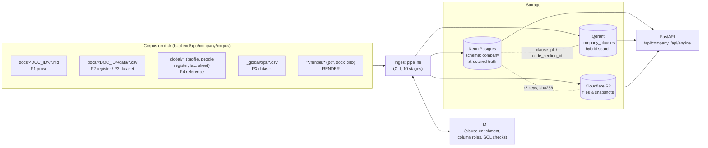
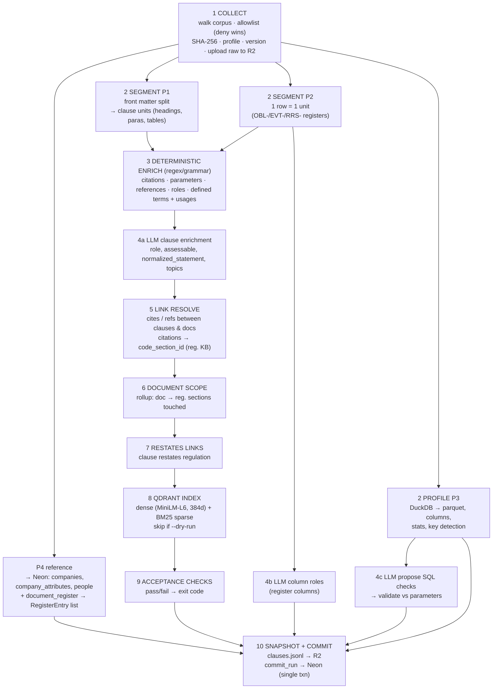
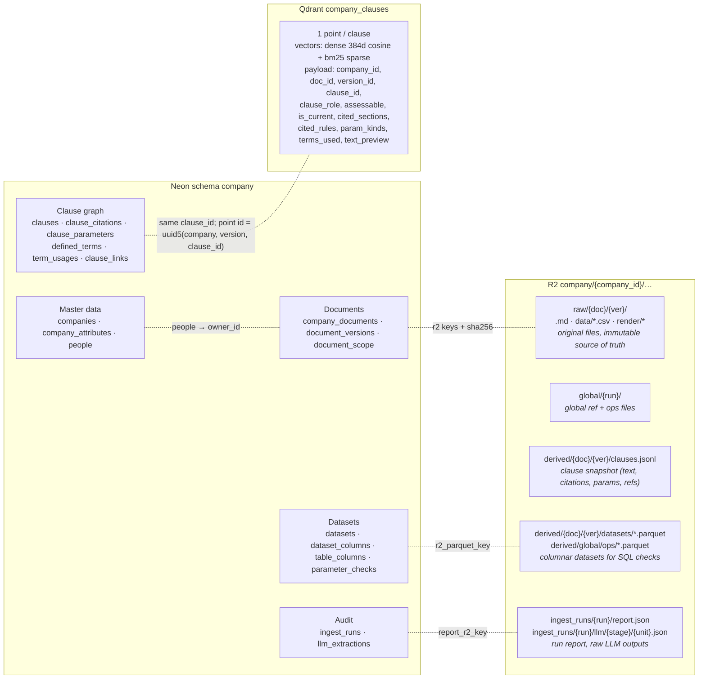
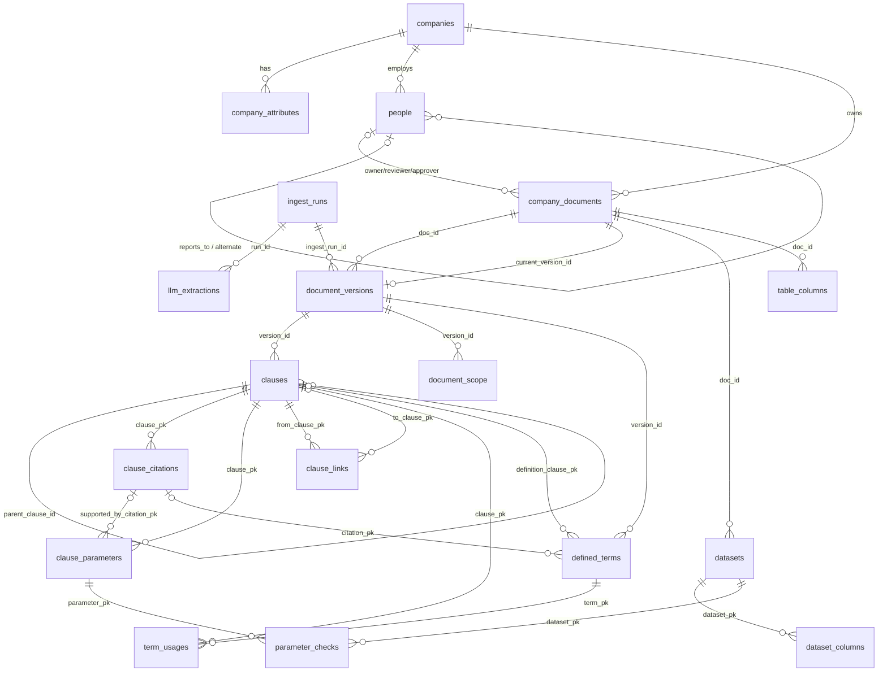
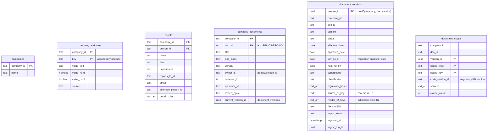
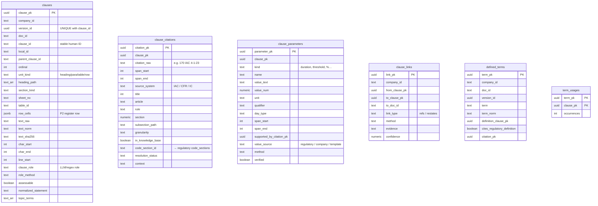
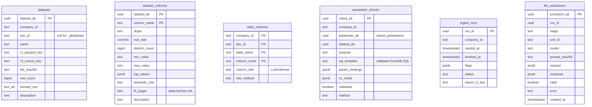
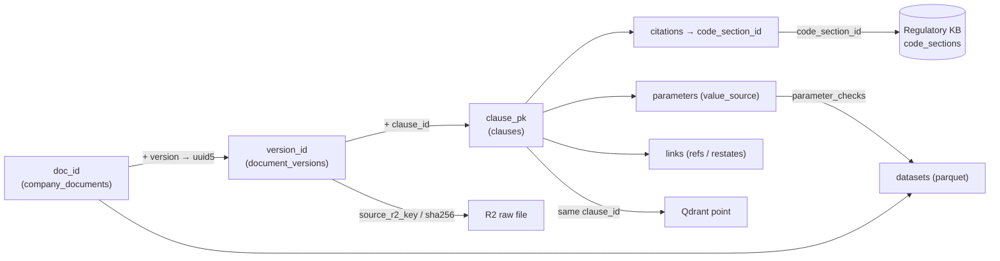

# Company Document Ingestion — Architecture & Schema

Code: `backend/app/company_ingest/` · Entry: `cli/ingest.py` · Schema: `store/schema.sql`
Flags: `--no-llm` · `--no-datasets` · `--rebuild` · `--dry-run` (no Neon/R2/Qdrant writes)

---

## 1. System Architecture

---

## 2. Pipeline Workflow

### File profiles

| Profile | Match rule | Processing | Raw → R2 key |
|---|---|---|---|
| **P1 prose** | `docs/<ID>/<ID>_vX.md` | segment → clauses | `raw/{doc}/{ver}/file.md` |
| **P2 register** | `docs/<ID>/data/*.csv`, 1st col `*_id` = `OBL-/EVT-/RRS-…` | row → clause unit | `raw/{doc}/{ver}/data/{name}.csv` |
| **P3 dataset** | other CSVs, `_global/ops/*.csv` | DuckDB profile → parquet | `raw/…/data/` or `global/{run}/ops/…` |
| **P4 reference** | `_global/*` non-ops | loaded into Neon | `global/{run}/…` |
| **RENDER** | any `render/` dir | stored only (not parsed) | `raw/{doc}/{ver}/render/…` |

---

## 3. Where Everything Goes

| Store | Holds | Answers |
|---|---|---|
| **R2** | raw files, clause snapshots, parquet, run reports | "Show me the original / re-run a check / audit a run" |
| **Neon** | structured, relational clause graph + metadata | "Who owns it? what does clause X cite/define/link to? which params?" |
| **Qdrant** | clause embeddings + filterable payload | "Which clauses are semantically/lexically relevant to this query/regulation?" |

---

## 4. Data Schema (Neon, `company` schema)

> No FOREIGN KEY constraints are declared in DDL — all relationships below are logical (enforced by the pipeline).
> Only `PK`/`UNIQUE` noted. Indexes: `clauses(doc_id)`, `clauses(clause_id)`, `clause_citations(code_section_id, clause_pk)`, `clause_parameters(clause_pk)`, `clause_links(from_clause_pk, to_clause_pk)`, `document_scope(scope_key)`.

### 4.1 Entity-relationship diagram

### 4.2 Master & document tables

### 4.3 Clause graph tables

### 4.4 Dataset, check & audit tables

---

## 5. Key Linking Concepts

- **Deterministic IDs**: `stable_uuid(company, doc, version)` → re-runs are idempotent (upserts).
- **`value_source`** on parameters: `regulatory` (restates law + has citation) · `company` (internal target/position) · `template` (template field/definition).
- **`parameter_checks`** tie a clause parameter to a dataset via validated SQL — verifies stated policy against actual data.
- **Qdrant ↔ Neon**: shared `clause_id`; Qdrant `is_current` flag marks the live version.

## 6. Known Gaps (from code review)

- CLI passes hardcoded `"v1"` as `version_id` to Qdrant upsert and R2 snapshot; Neon uses the real uuid5 version → payload/path `version_id` ≠ `document_versions.version_id`.
- `mark_previous_versions_stale()` exists but is not called by the CLI → old versions may remain `is_current=true`.
- `report.json` writer (`store/commit.py::write_report`) is not called; `ingest_runs.report_r2_key` is stored as `NULL`.
- No DB-level foreign keys; referential integrity is pipeline-only.
